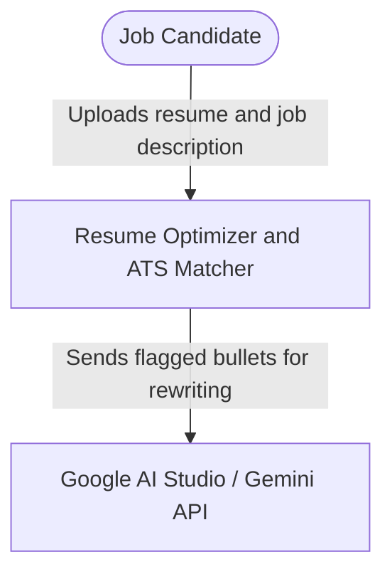
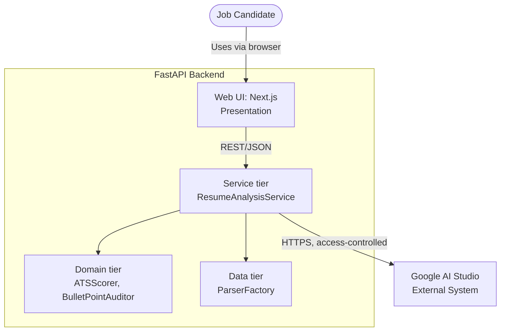
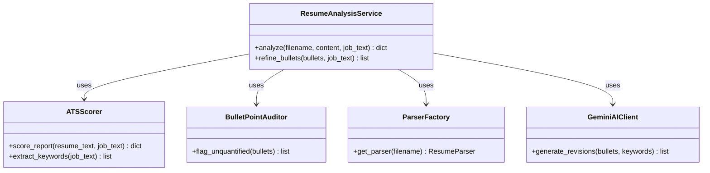
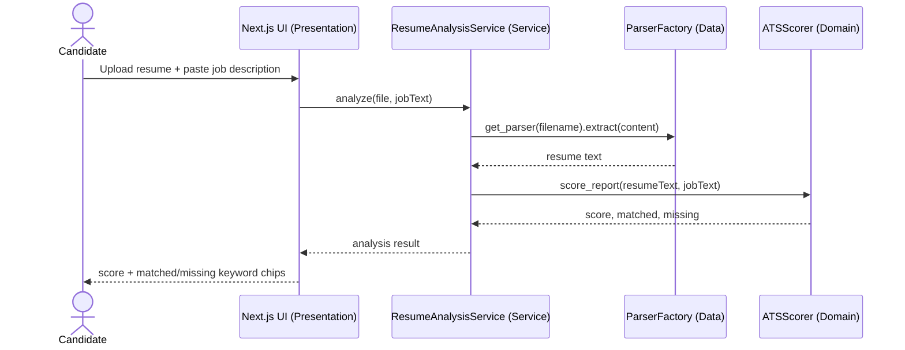

# AI-Powered Resume Optimizer & ATS Matcher


**Student:** Monisha Kummari · **Course:** CEN 5064 Software Design, Fall 2026 · **Partner:** @DavLien

## Project Description

An interactive full-stack web application that evaluates and optimizes candidate
resumes against a specific job description. The user uploads a resume (PDF/DOCX)
and pastes a target job posting; the app returns an ATS keyword-match score that
shows which required skills the resume already has and which it is missing, and
(for authorized users) rewrites weak experience bullet points with AI.

The design deliberately separates **deterministic domain logic** from the
**generative AI**: keyword scoring and bullet auditing run entirely in custom
Python domain rules (no AI, fully testable), while Google's Gemini is invoked
only for the generative task of rewriting flagged bullets.

**Core features:**
1. **Document parsing** — extracts raw text locally from uploaded PDF/DOCX files.
2. **ATS keyword analysis** — matches the resume against a curated set of real
   skills found in the job description and reports a score plus the matched and
   missing keywords.
3. **Bullet-point auditing** — flags experience bullets that lack a quantified
   metric.
4. **AI bullet refinement** — rewrites flagged bullets with Google Gemini,
   tailored to the job; access-controlled so it cannot be abused.

**Tech stack:**
- **Frontend:** Next.js (React) — drag-and-drop upload, score visualizer, AI panel.
- **Backend:** Python + FastAPI (n-tier: Presentation / Service / Domain / Data).
- **AI:** Google AI Studio — Gemini (`models/gemini-3.8-flash`), the single
  external service.

## How to run

The app has two parts: a Python/FastAPI **backend** and a Next.js **frontend**.
Run each in its own terminal.

### 1. Backend (Python 3.12, FastAPI)

```bash
# from the repo root
python3.12 -m venv .venv
source .venv/bin/activate        # Windows: .venv\Scripts\activate
pip install -r requirements.txt
python -m uvicorn main:app --reload
```

The API runs on <http://127.0.0.1:8000> (Swagger docs at `/docs`).

### 2. Frontend (Next.js)

In a **second terminal**:

```bash
cd frontend
npm install
npm run dev
```

Open <http://localhost:3000>. Drag and drop a resume, paste a job description,
click **Analyze resume** to see the score with matched/missing keyword chips,
then (with an access token) paste bullet points and click **Rewrite with AI**.

Two example inputs are included for a quick demo: `example_resume.pdf` and
`example_job_description.txt`.

### 3. AI features (Gemini) — configuration and access control

The AI rewrite uses Google Gemini and spends the project owner's quota, so it is
protected. Copy `.env.example` to `.env` (the real `.env` is git-ignored and must
never be committed) and set:

```
GEMINI_API_KEY=your-gemini-api-key-here     # from https://aistudio.google.com
AI_ACCESS_TOKEN=secret-token
```

- The free features (upload, parse, ATS score) work with no key and no token.
- The AI endpoint requires the `AI_ACCESS_TOKEN` value in an `X-AI-Token` header.
  In the app, paste that token into the "AI access token" field. Requests without
  a valid token get `403` and never trigger a Gemini call, so public visitors
  cannot exhaust the owner's credits. If no token is configured on the server, the
  AI endpoint is disabled for everyone (`503`).

To verify the live Gemini call works after setting your key:

```bash
python manual_ai_check.py
```

### Endpoints

- **POST `/api/upload`** — resume file + job description → ATS score, matched
  keywords, missing keywords, extracted text. Free and open to everyone.
- **POST `/api/refine`** — bullet points + job description → AI-rewritten
  `before`/`after` pairs. Access-controlled (see above).

### Run the backend tests

```bash
pytest -q
```

Tests mock the Gemini API, so they make no network calls and need no key.

## Architecture

The system is an n-tier (layered) application. Dependencies point downward only:
Presentation → Service → Domain / Data. The Domain tier holds the business rules
and never imports FastAPI or the AI SDK; the Data tier holds the parsing and the
external Gemini call.

### Tier breakdown

| Tier | Component | Responsibilities in THIS system |
| :--- | :--- | :--- |
| **Presentation** | Next.js page (`frontend/app/page.js`) | Drag-and-drop upload with client-side PDF/DOCX validation, job-description and bullets input, score + keyword display, AI rewrite panel. |
| | FastAPI routes (`main.py`) | `/api/upload` and `/api/refine` HTTP endpoints; token gate; maps errors to HTTP responses. |
| **Service** | `ResumeAnalysisService` | Orchestrates parsing, scoring, auditing, and the AI call. Holds no business rules itself. |
| **Domain** | `ATSScorer` | Deterministic keyword scoring against a curated skill set; returns score + matched + missing keywords. |
| | `BulletPointAuditor` | Flags experience bullets that contain no quantified metric. |
| **Data** | `ResumeParser` / `PdfParser` / `DocxParser` / `ParserFactory` | Factory-Method document parsing: extracts raw text from PDF/DOCX. |
| | `GeminiAIClient` | The only component that talks to the Gemini SDK / network; builds the prompt and parses the response. |

### C4 — Context & Container





### UML — Class & Sequence





## Architecture Decision Records

Decisions live in [`docs/adr/`](docs/adr/). Creational-pattern map:
[`docs/pattern-map.md`](docs/pattern-map.md).

| # | Decision | Status |
|---|----------|--------|
| [001](docs/adr/adr-001.md) | Build a Resume Analyzer using deterministic logic and Google Gemini | accepted |
| [002](docs/adr/adr-002.md) | Use the FastAPI Swagger UI for the initial working slice | accepted |
| [003](docs/adr/adr-003.md) | Protect the AI feature with a shared access token and env-var secrets | accepted |

## Weekly log

- Week 1 (Aug 24): repo created, project idea drafted
- Week 2 (Aug 31): Tier breakdown mapped.
- Week 3 (Sep 7): C4 Context/Container rendered in Mermaid.
- Week 4 (Sep 14): UML Class/Sequence diagrams rendered in Mermaid.
- Week 5 (Sep 21): Project board created, core use cases logged as Issues, CI pipeline initialized (green), and ADR-001 written.
- Week 6 (Sep 28): Issue #1 — PDF/DOCX parsing endpoint.
- Week 7 (Oct 5): Finished Issue #1; added Issue #2 (ATS scoring); ADR-002.
- Week 8 (Oct 12): Wired the Domain scorer into `/api/upload` end-to-end.
- Week 9 (Oct 19): Issue #3 — Gemini bullet refinement (GeminiAIClient, `/api/refine`, token security, ADR-003).
- Week 10-11 (Oct 26 - Nov 9): Issue #4 — Next.js frontend, curated-skill ATS scoring, Factory Method parser, pattern map.
- Week 12-13 (Nov 16): Hardening (AI call timeout), final doc update, demo.

## Issues (use-case backlog)

- Issue #1: Setup PDF/DOCX document parsing endpoint — **done**
- Issue #2: Implement ATS keyword-overlap scoring — **done**
- Issue #3: AI bullet-point refinement (Gemini, access-controlled) — **done**
- Issue #4: UI file upload & visualization (Next.js frontend) — **done**

## Known limitations

- Keyword matching uses a curated skills dictionary (`domain/ats_scorer.py`);
  skills not in that list are not scored. Extend the dictionary as needed.
- The AI rewrite depends on Google Gemini availability and the free-tier quota.
- Analysis is stateless — results are not persisted to a database yet.
